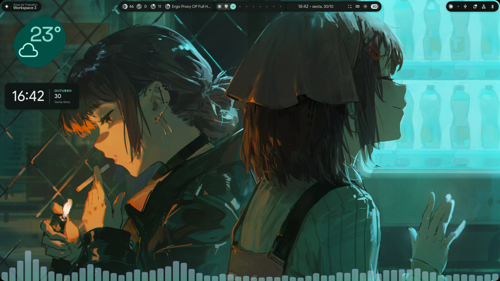
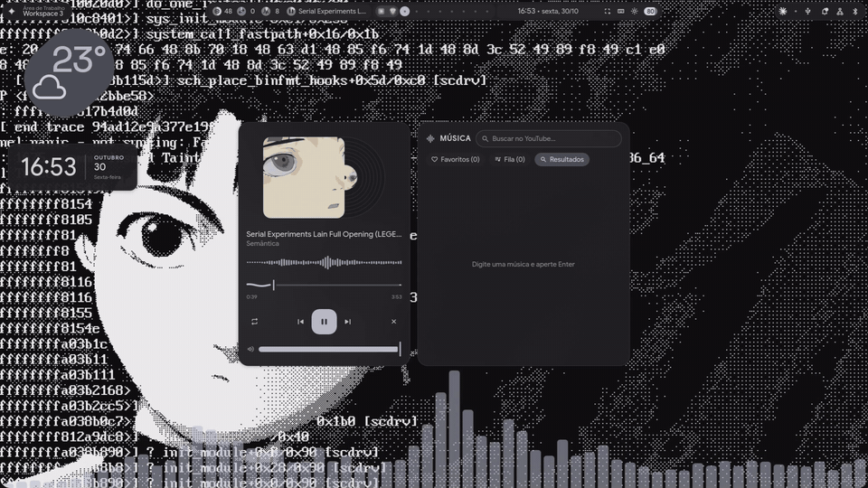
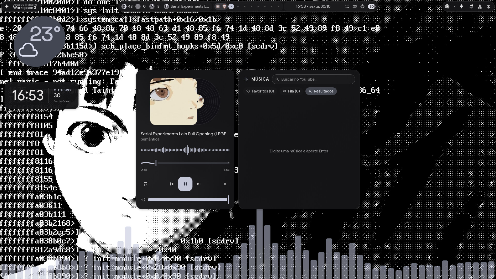
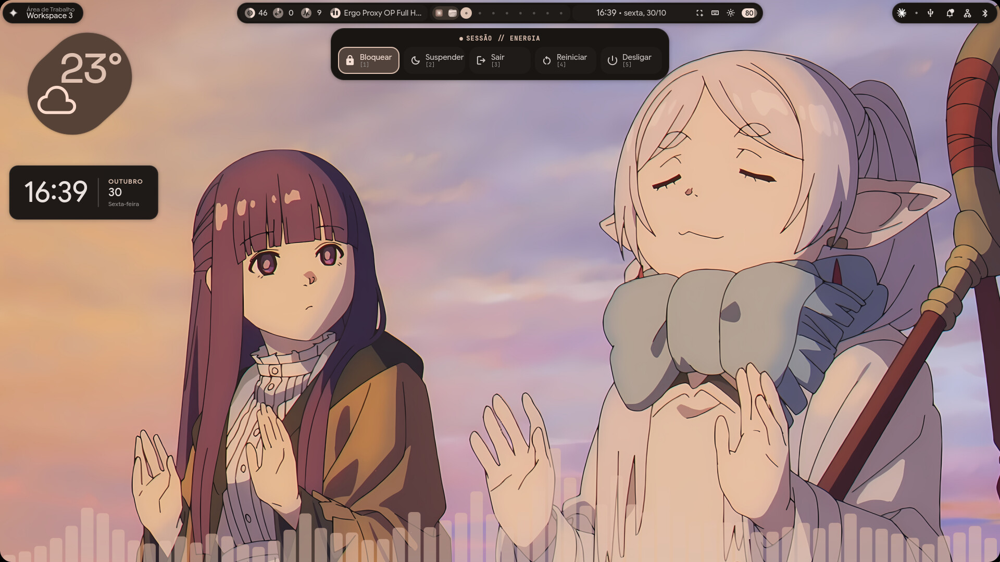
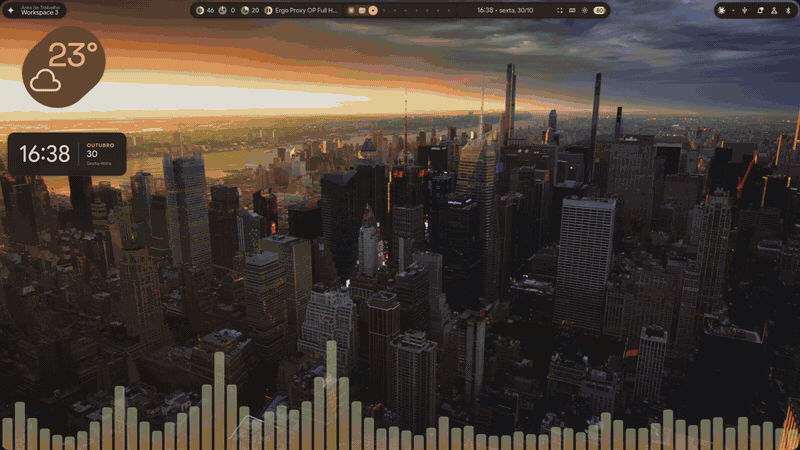
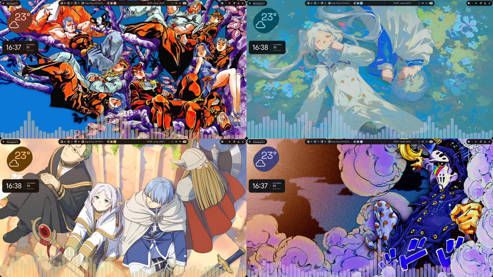

# dotfiles

Meu rice de Hyprland no CachyOS, baseado no [illogical-impulse](https://github.com/end-4/dots-hyprland) do end-4 (shell em Quickshell, Material 3 com cores tiradas do wallpaper).



## O que tem de diferente do ii original

| | |
|---|---|
| **Barra em 3 ilhas** | Pílulas flutuantes (esquerda / meio / direita). `bar.islands` no `config.json` |
| **Player de música** | Busca e toca do YouTube (yt-dlp + mpv), fila, favoritos, capa com disco de vinil girando e ondas do cava. Também controla Spotify/navegador via MPRIS |
| **Cava na área de trabalho** | Barras na base da tela, atrás das janelas, só enquanto toca música. `background.widgets.visualizer` |
| **Relógio-card** | `09:04 │ OUTUBRO 27 Terça` na área de trabalho. `background.widgets.clock.style: "card"` |
| **Menu de energia em pílula** | Desce de baixo da barra; Sair/Reiniciar/Desligar pedem confirmação |
| **Troca automática de wallpaper** | A cada N minutos, sem repetir até passar por todos. `background.autoChange` |
| **Minimizar de verdade** | Super+H esconde a janela; ícones dos minimizados na barra |
| **Pendrives na barra** | Ícone com Montar / Abrir / Ejetar |
| **Calendário** | Clique no relógio da barra |

## Como funciona

### Player de música — `Super+M`

Digite o nome da música e aperte Enter: o yt-dlp baixa o áudio para `~/.cache/ii-music` e o mpv toca em segundo plano. Tem fila, favoritos, vinil girando atrás da capa e ondas do cava. Se não houver nada do player tocando, controla o Spotify/navegador via MPRIS.



<details>
<summary>Print estático</summary>



</details>

### Cava na área de trabalho

Barras gigantes na base da tela, com as cores do wallpaper. Aparecem sozinhas quando começa a tocar música e somem quando para.

### Menu de energia em pílula — `Super+Esc`

Desce de baixo da barra. Teclas 1–5 escolhem a opção; Sair, Reiniciar e Desligar pedem um segundo clique para confirmar.



### Relógio-card e wallpaper

O relógio-card fica na área de trabalho e o clique no relógio da barra abre o calendário. O wallpaper troca sozinho a cada 30 min (`background.autoChange` no `config.json`) e as cores do shell acompanham.





## Instalação

1. Instale o [illogical-impulse](https://github.com/end-4/dots-hyprland) normalmente.
2. Copie as pastas deste repositório para `~/.config/` (faça backup das suas antes).
3. Dependências extras do player: `sudo pacman -S yt-dlp mpv-mpris cava socat`
4. Atalhos (em `~/.config/hypr/custom/keybinds.lua`, que não faz parte deste repositório):

```lua
hl.unbind("SUPER + M")
hl.bind("SUPER + M", hl.dsp.global("quickshell:musicPlayerToggle"), {description = "Shell: Music player"})
hl.bind("SUPER + Escape", hl.dsp.global("quickshell:powerPillToggle"), {description = "Shell: Power menu (pill)"})
hl.bind("SUPER + H", hl.dsp.global("quickshell:minimizeToggle"), {description = "Window: Minimize / restore"})
hl.bind("SUPER + SHIFT + H", hl.dsp.global("quickshell:minimizeRestoreLast"), {description = "Window: Restore last minimized"})
```

## Atalhos

**Deste rice**

| Tecla | Ação |
|---|---|
| Super+M | Player de música |
| Super+Esc | Menu de energia em pílula |
| Super+H / Super+Shift+H | Minimizar / restaurar |

**Shell**

| Tecla | Ação |
|---|---|
| Super | Busca / lançador de apps |
| Super+Tab | Visão geral das áreas de trabalho |
| Super+A / Super+N | Barra lateral esquerda / direita |
| Super+V | Histórico da área de transferência |
| Super+. | Emojis |
| Super+/ | Lista de todos os atalhos |
| Super+J | Mostrar / esconder a barra |
| Ctrl+Super+T | Escolher wallpaper |
| Ctrl+Super+Alt+T | Wallpaper aleatório |
| Ctrl+Super+R | Reiniciar o Quickshell |
| Ctrl+Alt+Del | Menu de sessão completo |

**Janelas e áreas de trabalho**

| Tecla | Ação |
|---|---|
| Super+Q | Fechar janela |
| Super+F / Super+D | Tela cheia / maximizar |
| Super+Alt+Espaço | Flutuar / encaixar |
| Super+P | Fixar janela em todas as áreas |
| Super+setas / Super+Shift+setas | Mudar foco / mover janela |
| Super+1…0 | Ir para a área de trabalho |
| Super+Alt+1…0 | Mandar janela para a área de trabalho |
| Super+S | Área de rascunho (scratchpad) |
| Super+arrastar (botão esq. / dir.) | Mover / redimensionar janela |

**Apps e utilitários**

| Tecla | Ação |
|---|---|
| Super+Enter (ou Super+T) | Terminal |
| Super+E | Gerenciador de arquivos |
| Super+W | Navegador |
| Super+C | Editor de código |
| Super+Shift+S | Print de uma área |
| Print | Print da tela inteira (copia) |
| Super+Shift+R | Gravar uma área da tela |
| Super+Shift+X | OCR (copiar texto de uma área) |
| Super+Shift+C | Conta-gotas de cor |
| Super+Shift+P / Super+Shift+N | Play-pause / próxima música |
| Super+L / Super+Shift+L | Bloquear / suspender |

## Créditos e licença

- Shell [illogical-impulse](https://github.com/end-4/dots-hyprland) por [end-4](https://github.com/end-4) e colaboradores — GPL-3.0.
- Visual do player e da barra inspirado num rice postado no r/hyprland.
- As modificações também são distribuídas sob a [GPL-3.0](LICENSE).
